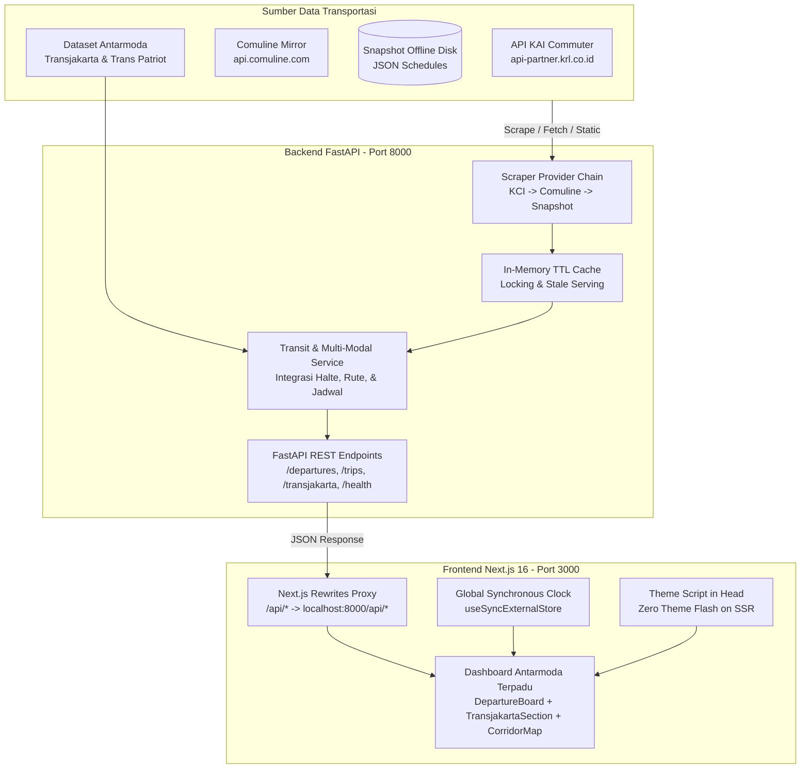

# 🚆🚌 Bekasi Transit Hub — Platform Transportasi Publik All-in-One KRL & Transjakarta

> Dashboard web fullstack multi-modal terintegrasi (*All-in-One*) untuk kawasan Bekasi: menggabungkan pemantauan real-time KRL Commuter Line Cikarang dengan jaringan bus BRT Transjakarta dan bus kota Trans Patriot. Dilengkapi backend scraper real-time berbasis Python (FastAPI) dan antarmuka modern Next.js 16.

---

## 📋 Daftar Isi

- [Tentang Proyek](#-tentang-proyek)
- [Arsitektur Sistem](#-arsitektur-sistem)
- [Fitur Utama](#-fitur-utama)
- [Integrasi Antarmoda KRL + Transjakarta](#-integrasi-antarmoda-krl--transjakarta)
- [Struktur Direktori](#-struktur-direktori)
- [Teknologi yang Digunakan](#-teknologi-yang-digunakan)
- [Panduan Menjalankan di Lokal](#-panduan-menjalankan-di-lokal)
  - [1. Prasyarat](#1-prasyarat)
  - [2. Menjalankan Backend (Python / FastAPI)](#2-menjalankan-backend-python--fastapi)
  - [3. Menjalankan Frontend (Next.js 16)](#3-menjalankan-frontend-nextjs-16)
- [CLI Scraper & Snapshot Offline](#-cli-scraper--snapshot-offline)
- [Dokumentasi REST API](#-dokumentasi-rest-api)
- [Pengujian & Kualitas Kode](#-pengujian--kualitas-kode)
- [Panduan Upload ke GitHub](#-panduan-upload-ke-github)
- [Panduan Deployment](#-panduan-deployment)
- [Lisensi & Atribusi Data](#-lisensi--atribusi-data)

---

## 💡 Tentang Proyek

Bekasi merupakan salah satu wilayah komuter terpadat dengan mobilitas harian ratusan ribu jiwa menuju Jakarta. Banyak komuter tidak hanya mengandalkan kereta KRL saja, namun sering kali harus melanjutkan perjalanan menggunakan bus Transjakarta atau bus kota Trans Patriot.

Jika hanya mengandalkan aplikasi kereta konvensional, penumpang kesulitan mengetahui koneksi halte bus terdekat saat turun di peron. **Bekasi Transit Hub** menyatukan ekosistem tersebut ke dalam satu dasbor (*All-in-One Transit Platform*):
1. **Multi-Modal Antarmoda**: Jadwal KRL Commuter Line langsung terhubung dengan integrasi halte Transjakarta, estimasi jalan kaki, dan panduan transfer fisik (seperti Skybridge Cakung dan Pintu Selatan Stasiun Bekasi).
2. **Memiliki Ketahanan Tinggi (*High Availability*)**: Menggunakan rantai penyedia data (*multi-tier fallback*) — mulai dari mirror publik Comuline, API resmi KAI Commuter, hingga *local disk snapshot* jika seluruh jaringan eksternal bermasalah.
3. **Berorientasi pada Penumpang**: Jadwal dipisahkan secara tegas berdasarkan arah perjalanan (**Arah Jakarta** vs **Arah Cikarang**), dilengkapi hitung mundur (*countdown*) real-time, waktu tempuh nyata, dan rute pemberhentian KA.
4. **Desain Anti "AI-Slope"**: Mengadopsi bahasa visual papan informasi stasiun (*transit signage*) dengan tipografi proporsional, grid presisi, token warna resmi KRL Cikarang (`#0084D8`), dan transisi tema gelap/terang tanpa distorsi visual.

---

## 🏛️ Arsitektur Sistem



---

## ✨ Fitur Utama

| Fitur | Deskripsi |
| :--- | :--- |
| 🚌 **Integrasi Antarmoda Transjakarta** | Informasi rute bus BRT (B11, B12, B21, B22, Koridor 11), bus kota Trans Patriot (TP1, TP2, TP3), dan Royaltrans terdekat dari peron stasiun KRL. |
| 🚶 **Panduan Transfer Fisik** | Panduan jalan kaki nyata (misal: Skybridge Cakung lantai 2 ke Koridor 11, Pintu Selatan Stasiun Bekasi, JPO Jatinegara). |
| 🗺️ **Peta Jalur Koridor Interaktif** | Peta strip visual stasiun Bekasi (Kranji, Bekasi, Bekasi Timur, Tambun, Cibitung, Telagamurni, Cikarang) yang berfungsi ganda sebagai navigasi stasiun instan. |
| ⏱️ **Papan Keberangkatan Real-Time** | Pemisahan otomatis arah Jakarta dan Cikarang, live countdown, waktu kedatangan di tujuan, dan animasi urgensi (kedip saat kereta tiba ≤ 2 menit). |
| 📊 **Analisis Frekuensi Jadwal per Jam** | Histogram grafis interaktif jadwal kereta sepanjang 24 jam operasional dengan penanda jam aktif saat ini dan penanda jam sibuk (*peak hours*). |
| 🚊 **Timeline Rute Perjalanan KRL (Modal)** | Pelacak urutan stasiun pemberhentian kereta dengan status *passed* (terlewati), *next* (terdekat), dan *upcoming* (mendatang). |
| 🚌 **Timeline Rute Bus & Halte (Modal)** | Modal inspeksi daftar halte rute Transjakarta, tarif, jam operasi, interval bus (headway), dan stasiun KRL terhubung. |
| 🧭 **Pencarian Kereta Langsung (Trip Planner)** | Pencarian perjalanan langsung tanpa transit (misal Bekasi ke Manggarai, Sudirman, atau Tanah Abang) lengkap dengan estimasi durasi menit. |
| 🌓 **Dark & Light Mode Zero-Flash** | Dukungan penuh mode Terang, Gelap, dan Sistem dengan teknik *head script injection* untuk mencegah kedipan putih saat halaman dimuat. |
| 🛡️ **Fallback Offline Otomatis** | Jika koneksi scraper internet bermasalah, aplikasi otomatis menyajikan data cadangan disk snapshot dengan status badge bertanda *Snapshot Offline*. |

---

## 📁 Struktur Direktori

```text
projek 2/
├── .gitignore               # Aturan ignore file git untuk Node & Python
├── README.md                # Dokumentasi utama proyek
├── backend/                 # Layanan Backend Python & Scraper
│   ├── pyproject.toml       # Definisi dependensi uv & paket Python
│   ├── uv.lock              # Lockfile dependensi Python
│   ├── .env.example         # Contoh konfigurasi environment backend
│   ├── data/
│   │   └── snapshot/        # Data cadangan jadwal offline (12 stasiun JSON)
│   ├── tests/
│   │   └── test_transit.py  # Unit test suite logika transit & provider
│   └── app/
│       ├── main.py          # FastAPI application & route definitions
│       ├── config.py        # Pengaturan aplikasi & zoneinfo WIB
│       ├── models.py        # Skema Pydantic v2 untuk API request/response
│       ├── stations.py      # Referensi stasiun koridor & arah lintasan
│       ├── cache.py         # In-memory thread-safe TTL cache
│       ├── cli.py           # CLI scraper untuk scraping & pembuatan snapshot
│       ├── scrapers/        # Implementasi provider (kci, comuline, snapshot)
│       └── services/        # Logika bisnis jadwal & perakitan rute
└── web/                     # Antarmuka Pengguna Next.js 16
    ├── package.json         # Dependensi frontend & scripts
    ├── next.config.ts       # Konfigurasi Next.js & proxy rewrites /api/*
    ├── tsconfig.json        # Konfigurasi TypeScript
    ├── .env.example         # Contoh konfigurasi environment web
    ├── README.md            # Dokumentasi khusus frontend
    └── src/
        ├── app/
        │   ├── layout.tsx   # Root layout (Web fonts, Theme Script, Metadata)
        │   ├── page.tsx     # Halaman utama dashboard
        │   └── globals.css  # CSS tokens & visual hierarchy
        ├── components/      # Komponen UI (Header, DepartureBoard, CorridorMap, dsb.)
        ├── hooks/           # Custom hook (useNow, useApi)
        └── lib/             # Helper client API, manipulasi waktu WIB, & preferensi tema
```

---

## 🛠️ Teknologi yang Digunakan

### **Backend**
- **Python 3.12+**
- **FastAPI 0.115+**: Framework REST API asinkron berperforma tinggi.
- **Pydantic v2**: Validasi data dan serialisasi skema otomatis.
- **HTTPX**: Klien HTTP asinkron untuk scraping data online KRL.
- **Uvicorn**: Server ASGI standar produksi.
- **uv**: Tool manajemen paket dan virtual environment Python ultra-cepat.
- **Pytest & Ruff**: Pengujian unit otomatis dan linter kode terstandar.

### **Frontend**
- **Next.js 16.4 (App Router)** dengan **Turbopack**.
- **React 19**.
- **TypeScript 5**.
- **Vanilla CSS Modules**: Kontrol desain murni tanpa framework CSS berat, memaksimalkan performa dan estetika *anti-generic*.
- **Google Fonts**: *Archivo* (keterbacaan signage) & *IBM Plex Mono* (angka jadwal tabular).

---

## 🚀 Panduan Menjalankan di Lokal

### 1. Prasyarat
- **Node.js** (versi 18.18+ atau 20+) & **npm**
- **Python** (versi 3.11+) atau **uv** (`curl -LsSf https://astral.sh/uv/install.sh | sh`)

---

### 2. Menjalankan Backend (Python / FastAPI)

1. Masuk ke direktori `backend`:
   ```bash
   cd backend
   ```

2. Pasang dependensi dan aktifkan virtual environment:
   - Jika menggunakan `uv` (sangat disarankan):
     ```bash
     uv sync
     ```
   - Atau menggunakan `pip` standar:
     ```bash
     python3 -m venv .venv
     source .venv/bin/activate
     pip install -e .
     ```

3. Jalankan server backend:
   - Menggunakan `uv`:
     ```bash
     uv run uvicorn app.main:app --reload --port 8000
     ```
   - Menggunakan `pip`:
     ```bash
     uvicorn app.main:app --reload --port 8000
     ```

4. Periksa apakah backend sudah aktif:
   - Akses Health check: [http://localhost:8000/api/health](http://localhost:8000/api/health)
   - Dokumentasi interaktif Swagger UI: [http://localhost:8000/docs](http://localhost:8000/docs)

---

### 3. Menjalankan Frontend (Next.js 16)

1. Buka terminal baru dan masuk ke direktori `web`:
   ```bash
   cd web
   ```

2. Pasang dependensi:
   ```bash
   npm install
   ```

3. Jalankan server pengembangan:
   ```bash
   npm run dev
   ```

4. Buka browser di [http://localhost:3000](http://localhost:3000). Dashboard Bekasi Transit siap digunakan!

---

## 📟 CLI Scraper & Snapshot Offline

Backend dilengkapi dengan kakas CLI untuk melakukan scraping data stasiun secara manual atau memperbarui snapshot offline di disk.

```bash
# Jalankan dari folder backend:

# 1. Scraping data jadwal mentah satu stasiun (misal: Stasiun Bekasi)
uv run python -m app.cli scrape BKS

# 2. Scraping dalam format output JSON
uv run python -m app.cli scrape BKS --json

# 3. Memperbarui seluruh snapshot offline (12 stasiun koridor Cikarang-Jakarta)
uv run python -m app.cli snapshot
```

File snapshot akan tersimpan di `backend/data/snapshot/schedules/` sebagai jaminan bahwa dashboard selalu dapat berfungsi meskipun jaringan internet stasiun terputus.

---

## 📡 Dokumentasi REST API

Backend menyediakan endpoint RESTful yang bersih dan terdokumentasi rapi:

| Method | Endpoint | Keterangan |
| :--- | :--- | :--- |
| `GET` | `/api/health` | Status server, versi, jam sistem (WIB), dan provider yang aktif. |
| `GET` | `/api/stations` | Daftar stasiun koridor Bekasi dan direktori seluruh stasiun KRL. |
| `GET` | `/api/stations/{id}/departures` | Jadwal keberangkatan berikutnya (Arah Jakarta & Cikarang) + metrik ringkasan. |
| `GET` | `/api/stations/{id}/timetable` | Jadwal lengkap 1 hari operasional (03:00 - 03:00 WIB berikutnya). |
| `GET` | `/api/stations/{id}/transjakarta` | Integrasi halte bus terdekat, jarak jalan kaki, panduan transfer fisik, dan rute bus penghubung di stasiun terkait. |
| `GET` | `/api/transjakarta/routes` | Katalog seluruh rute Transjakarta (BRT, Non-BRT, Royaltrans) & bus kota Trans Patriot koridor Bekasi — Jakarta. |
| `GET` | `/api/trains/{id}/route` | Urutan stasiun pemberhentian satu nomor KA (status: passed/next/upcoming). |
| `GET` | `/api/trips?from={origin}&to={dest}` | Daftar jadwal kereta langsung dari stasiun asal ke stasiun tujuan. |

Dokumentasi OpenAPI / Swagger interaktif dapat diakses di `http://localhost:8000/docs`.

---

## 🧪 Pengujian & Kualitas Kode

Backend memiliki unit test komprehensif yang menguji logika normalisasi jadwal, pembagian arah, pencarian trip, dan fallback provider tanpa membutuhkan koneksi internet eksternal:

```bash
# Menjalankan unit test dengan pytest
cd backend
uv run pytest -v

# Menjalankan linter & formatting dengan Ruff
uv run ruff check .
uv run ruff format --check .
```

Untuk frontend:
```bash
# Pengecekan tipe data TypeScript & ESLint
cd web
npx tsc --noEmit
npm run lint

# Verifikasi bundle build produksi Next.js
npm run build
```

---

## 📤 Panduan Upload ke GitHub

Sebelum mengunggah ke GitHub, pastikan file konfigurasi `.gitignore` sudah mencakup direktori virtual environment dan `.next`.

Langkah-langkah inisialisasi Git:

```bash
# Masuk ke direktori utama proyek
cd "/Users/mac/Downloads/projek 2"

# 1. Inisialisasi Git repository
git init

# 2. Tambahkan semua file yang tidak di-ignore
git add .

# 3. Buat commit pertama
git commit -m "feat: initial commit fullstack Bekasi Transit dashboard & scrapers"

# 4. Ganti nama branch utama menjadi main
git branch -M main

# 5. Hubungkan ke repository GitHub Anda (ganti URL di bawah dengan repo Anda)
# git remote add origin https://github.com/USERNAME/bekasi-transit-dashboard.git

# 6. Push kode ke GitHub
# git push -u origin main
```

---

## 🌐 Panduan Deployment

### **Opsi 1: Frontend di Vercel**
1. Hubungkan repository GitHub Anda ke [Vercel](https://vercel.com).
2. Set **Root Directory** ke `web`.
3. Tambahkan Environment Variable:
   - `BACKEND_URL`: `https://api-transit-anda.railway.app` (URL backend FastAPI Anda).
4. Klik **Deploy**.

### **Opsi 2: Backend di Railway / Render / VPS**
- **Railway / Render**:
  - Gunakan `backend/` sebagai subdirektori.
  - Perintah start: `uvicorn app.main:app --host 0.0.0.0 --port $PORT`
  - Python runtime otomatis mendeteksi `pyproject.toml`.
- **Docker**:
  - Buat `Dockerfile` berbasis `python:3.12-slim`, lakukan `pip install .` dan jalankan `uvicorn app.main:app`.

---

## 📄 Lisensi & Atribusi Data

- **Data Jadwal KRL**: Hak cipta jadwal milik PT Kereta Commuter Indonesia (KAI Commuter). Data diakses melalui agregator publik Comuline dan portal resmi KAI Commuter untuk tujuan edukasi dan kemudahan akses informasi publik.
- **Source Code**: Dirilis di bawah lisensi [MIT](LICENSE). Silakan gunakan dan kembangkan untuk proyek portofolio atau kebutuhan transportasi publik lainnya.
